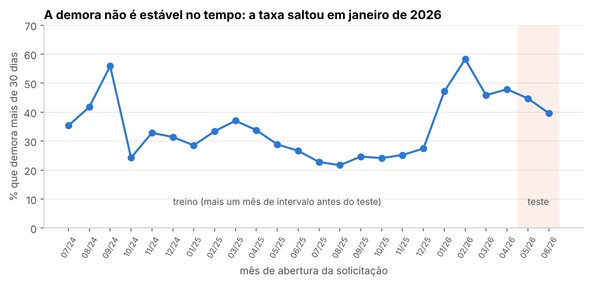
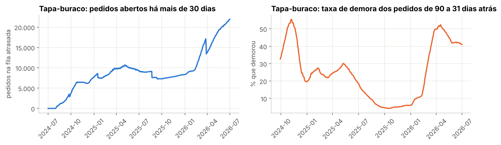
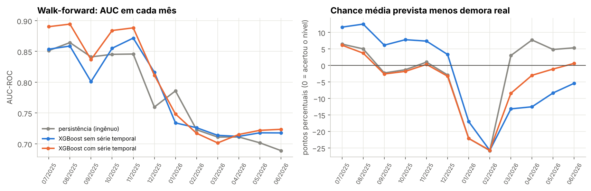

# Relatório de Machine Learning — SmartRoad Preditiva

**FIAP · Global Solution 2026.2 · CitizenTech · Inteligência Artificial & Machine Learning**
**Equipe:** Gustavo Viega Lopes Martins (RM555885), Gustavo Yuji Osugi (RM555034), Kaio Drago Lima Souza (RM556095), Otávio Santos de Lima Ferrão (RM556452) e Vitor Rivas Cardoso (RM556404)
**Notebook:** [`ml/smartroad_preditiva.ipynb`](ml/smartroad_preditiva.ipynb) · **Dados:** [`ml/dados/README.md`](ml/dados/README.md)

## 1. Problema e dados reais

O **SmartRoad** é o app em que o morador de São Paulo registra buracos, bueiros quebrados e calçadas danificadas e acompanha o andamento. Depois de registrar, a primeira dúvida de quem usa é *"isso vai demorar?"*, e o app não tem como responder. O indicador de impacto da nossa Ficha é justamente o tempo entre o registro e a conclusão.

**Pergunta de ML:** no momento em que uma ocorrência é registrada, dá para prever se ela vai **demorar mais de 30 dias para ser finalizada**? É uma classificação binária supervisionada, com **série temporal**: o ritmo da Prefeitura muda ao longo do tempo, e o modelo precisa enxergar isso.

**Dados:** solicitações reais do **SP156**, o canal oficial de pedidos de serviço da Prefeitura de São Paulo.

| | |
| --- | --- |
| Fonte | Portal de Dados Abertos da Prefeitura de São Paulo, conjunto "Dados do SP156 - Solicitações" |
| Link | https://dados.prefeitura.sp.gov.br/dataset/dados-do-sp156 |
| Período | pedidos abertos de 01/07/2024 a 30/06/2026, 2 anos corridos (8 arquivos trimestrais; os de 2025 e 2026 foram republicados em 10/08/2026) |
| Volume | 4.704.953 solicitações nos arquivos originais; 387.605 nos 9 serviços que correspondem ao app |
| Licença | Creative Commons CC0 |

Ficamos com os serviços de tapa-buraco, bueiros e galerias, e calçadas e guias. O tipo "Iluminação" do app ficou de fora, porque o SP156 não traz serviço de iluminação pública nesse período. O arquivo do 2º trimestre de 2024 não traz a coluna "Serviço", por isso a série começa em 01/07/2024: assim ela fica contínua, sem buraco no meio.

## 2. A série temporal

A taxa de demora **não é estável**: ficou entre 22% e 37% quase todo o período, teve um pico em setembro de 2024 (56%) e saltou para 40% a 58% a partir de janeiro de 2026.

Um modelo que trate cada pedido como uma linha isolada não enxerga isso. Por isso, para cada **serviço** e para cada **subprefeitura**, construímos séries diárias e damos ao modelo o valor delas **na manhã do dia do registro**:

| Indicador | O que mede |
| --- | --- |
| `vol7`, `vol30` | pedidos abertos nos 7 e nos 30 dias anteriores |
| `fila` | pedidos já abertos e ainda sem finalização |
| `fila_atrasada` | desses, quantos já passaram de 30 dias abertos |
| `ritmo30` | média de dias dos pedidos finalizados nos últimos 30 dias |
| `taxa_madura` | % que demorou entre os pedidos abertos de 90 a 31 dias atrás (o desfecho deles já é conhecido) |
| `tendencia` | `taxa_madura` recente menos a anterior: a demora está subindo ou caindo |

São 14 indicadores (7 do serviço e 7 da subprefeitura). **Regra anti-vazamento:** o indicador do dia D usa só eventos de dias anteriores a D, e a `taxa_madura` só olha pedidos com mais de 30 dias de vida, porque o desfecho de um pedido aberto há 10 dias ainda não é conhecido. O notebook tem um teste que refaz o cálculo com os dados cortados em duas datas diferentes e confere que o resultado é idêntico ao do cálculo completo.

## 3. Escolha do modelo

Escolhemos o **XGBoost** (`XGBClassifier`), entre as opções do enunciado, por quatro motivos:

- Os dados são uma **tabela** com variáveis categóricas e numéricas. Modelos de árvores costumam ser os melhores nesse formato e não exigem normalização.
- O efeito da região depende do serviço e da época. Árvores capturam essas **combinações** sozinhas.
- Temos a resposta de cada pedido, então o problema é supervisionado: KMeans + PCA não usa o rótulo. A série temporal entra como **entrada** (os 14 indicadores), não como arquitetura: uma LSTM precisaria de uma sequência longa por ocorrência, e cada pedido tem um único ponto no tempo. Uma MLP exigiria normalização e mais ajuste.
- Em relação ao Random Forest, o XGBoost tem controles diretos de complexidade, que usamos para estudar o overfitting, e devolve uma **probabilidade**, que é o que o app mostra ao cidadão.

## 4. Preparação e divisão treino/teste

**Limpeza** (384.139 linhas mantidas, 99,1% do recorte): removemos 2.241 pedidos cancelados pelo cidadão, 1.106 finalizados sem data, 21 de um canal que não consta no dicionário (RESOLUCAO) e 98 com coordenadas fora da cidade. Duas subprefeituras mudaram de nome no meio do período e foram unificadas.

**Alvo:** `demora = 1` quando o pedido não foi finalizado em até 30 dias, incluindo os que ainda estavam abertos. O limite de 30 dias foi escolhido porque todo pedido do recorte foi observado por mais de 30 dias antes da extração (última finalização em 10/08/2026). Assim o alvo é conhecido para 100% das linhas, e não precisamos descartar os pedidos ainda abertos, que são os mais demorados. No total, 35,1% dos pedidos demoram.

**Entradas** (só o que o app sabe na hora do registro, mais os 14 indicadores de série temporal): serviço, canal, subprefeitura, latitude, longitude, dia da semana e a série temporal. As categóricas passaram por *one-hot encoding* (63 colunas no total). Deixamos de fora o status, a data de finalização e o órgão responsável **do próprio pedido**, que são informações de depois da abertura e causariam vazamento. Também deixamos de fora o **mês do calendário**: com dois anos de dados ele só serve de marcador de época, e testamos que piora a previsão (Seção 6).

**Divisão por data, com intervalo de 30 dias:** teste com os pedidos de 01/05 a 30/06/2026 (26.459; 6,9%) e treino com os de 01/07/2024 a 31/03/2026 (342.311; 89,1%). Abril de 2026 fica de fora de propósito: em 1º de maio o desfecho de um pedido aberto em abril ainda não é conhecido, e treinar com ele seria usar informação do futuro. A taxa de demora mudou muito ao longo do período (34,0% no treino, 42,1% no teste), e o modelo será usado para prever pedidos futuros. Por isso ele precisa ser testado em meses que não viu.

## 5. Treino com diferentes hiperparâmetros

Testamos **18 combinações de 3 hiperparâmetros** com `GridSearchCV`: `max_depth` (3, 6, 9), `learning_rate` (0,03; 0,1; 0,3) e `n_estimators` (100, 300). A validação cruzada foi feita **só no treino**, com `TimeSeriesSplit` de 4 divisões e intervalo equivalente a 30 dias entre o treino e a validação de cada divisão. A métrica da busca foi a AUC-ROC.

A tabela e o gráfico das 18 combinações estão na Seção 5 do notebook. A melhor combinação foi `max_depth=6`, `learning_rate=0.03` e `n_estimators=300` (AUC de 0,800 na validação). As 7 primeiras ficaram entre 0,790 e 0,800, o que é um empate diante do desvio de 0,05 a 0,06 entre as divisões. A combinação mais complexa chegou a 0,987 no treino e ficou entre as piores na validação (0,772): decorou o treino. A mais simples teve uma das menores distâncias entre treino e validação, mas também uma das piores validações (0,764): aprendeu de menos.

## 6. Resultados em treino e teste

| Métrica | Treino | Teste | Diferença |
| --- | ---: | ---: | ---: |
| AUC-ROC | 0,872 | 0,724 | 0,148 |
| Acurácia | 0,801 | 0,681 | 0,120 |
| Acurácia balanceada | 0,756 | 0,654 | 0,103 |
| Precisão (classe "demora") | 0,753 | 0,668 | 0,085 |
| Recall (classe "demora") | 0,616 | 0,481 | 0,135 |
| F1 (classe "demora") | 0,678 | 0,559 | 0,118 |
| *Linha de base: sempre "não demora" (acurácia)* | *0,660* | *0,579* | |

**O modelo é útil fora do treino:** no teste, a acurácia fica 10,2 pontos acima da linha de base, e a acurácia balanceada sobe de 0,500 para 0,654.

**Há overfitting.** A AUC cai 0,15 do treino para o teste. Vemos duas causas: árvores profundas guardam detalhes do treino, e o ritmo da cidade mudou de regime (34,0% de demora no treino, 42,1% no teste, depois do salto de janeiro de 2026). Com divisão por sorteio, a AUC de teste seria 0,858: a divisão por data é o número honesto.

### A série temporal ajuda? Walk-forward e comparação com o ingênuo

Para responder com evidência, comparamos três previsores nos mesmos pedidos: a **persistência** (usa a taxa de demora recente do serviço como probabilidade, sem aprender nada), o **XGBoost sem série temporal** e o **XGBoost com série temporal** (o modelo final). Além do teste final, fizemos um **walk-forward de 12 meses**: para cada mês de jul/2025 a jun/2026, o modelo é treinado só com pedidos abertos até 30 dias antes do início do mês e testado naquele mês.

| | Persistência | XGBoost sem série temporal | **XGBoost com série temporal** |
| --- | ---: | ---: | ---: |
| AUC no teste final (mai e jun/2026) | 0,702 | 0,717 | **0,724** |
| Brier no teste final (menor é melhor) | 0,209 | 0,205 | **0,200** |
| AUC média, walk-forward de 12 meses | 0,777 | 0,782 | **0,794** |
| Brier médio, walk-forward | 0,175 | 0,177 | **0,169** |
| Erro médio do nível da chance prevista (walk-forward) | 7,3 p.p. | 10,9 p.p. | **6,6 p.p.** |

O que isso mostra, sem enfeite:

- **A série temporal ajuda, mas pouco.** O ganho de AUC é de 0,012 na média do walk-forward e aparece em 9 dos 12 meses. Ele é maior em jul a out/2025 (cerca de +0,03 a +0,04) e desaparece em fev e mar/2026, logo depois do salto de regime. No teste final, a diferença é pequena (AUC 0,724 contra 0,717).
- **O maior ganho é no nível da probabilidade**, e é isso que o app mostra ao cidadão. O erro médio da chance média prevista cai de 10,9 para 6,6 pontos percentuais, e o escore de Brier melhora de 0,177 para 0,169.
- **O histórico recente é o que mais pesa no modelo:** os 14 indicadores somam 80% do ganho, e só a taxa de demora recente do serviço (`taxa_madura`), 48%. Mas nenhum modelo antecipou o salto de janeiro de 2026: em fevereiro todos subestimaram a demora em cerca de 26 pontos percentuais.
- **O mês do calendário atrapalha.** Trocar a série temporal pelo número do mês fez a AUC média do walk-forward cair para 0,756, abaixo até do modelo sem nada disso (0,782).

**Pontos fracos.** O recall é de 0,48: com corte em 50%, o modelo deixa passar mais da metade das demoras. As probabilidades são razoavelmente confiáveis: o maior desvio entre o previsto e o que aconteceu é de cerca de 10 pontos percentuais (faixa de 40 a 60%: previu 50%, demorou 40%).

## 7. Conclusão: o que isso significa para o cidadão

**Sim, em parte, dá para prever.** Só com o que o SmartRoad sabe no registro e com o histórico recente do serviço e da região, o modelo estima a chance de demora melhor do que o acaso e do que a linha de base. Ele não acerta caso a caso. É uma estimativa.

- **Expectativa honesta já no registro.** Hoje o cidadão só vê "Recebida". Com o modelo, o app pode dizer o que costuma acontecer com pedidos parecidos. No teste, a mensagem "costumam ser finalizados em até 30 dias" apareceria em 62% dos pedidos, e 69% deles foram finalizados no prazo. A mensagem "costumam passar de 30 dias" apareceria em 22%, e 77% deles de fato passaram. Nos 16% restantes a chance fica perto de meio a meio, e o app deve dizer isso com clareza.
- **O tipo de problema pesa mais que tudo.** No teste, 24% dos pedidos de bueiro, 36% dos de buraco e 69% dos de calçada passaram de 30 dias. Quem mais depende de calçada em bom estado (idosos, pessoas com deficiência, quem anda com carrinho de bebê) é quem mais espera.
- **O endereço também pesa.** Nos dois anos analisados, a taxa de demora foi de 19% no Jabaquara e de 48% na Sé. Mostrar isso ajuda moradores e associações de bairro a cobrar com dados (ODS 11 e ODS 10).

**Limites.** "Finalizada" no SP156 indica que o protocolo foi encerrado, e não que o reparo foi feito. O ritmo da Prefeitura mudou bruscamente em janeiro de 2026, então o modelo precisa ser retreinado todo mês e reavaliado sempre em meses futuros. O arquivo do 1º trimestre de 2025 tem exatamente 1.048.575 linhas, o limite de uma planilha Excel, e pode estar incompleto. Dois anos ainda não bastam para aprender sazonalidade anual.

**Próximos passos.** Usar mais anos de dados, juntar a chuva diária do INMET, testar a previsão da própria série (por exemplo, a taxa semanal de demora por serviço) como entrada adicional e servir a previsão pelo backend para a tela de detalhe da ocorrência, com as séries atualizadas uma vez por dia.
