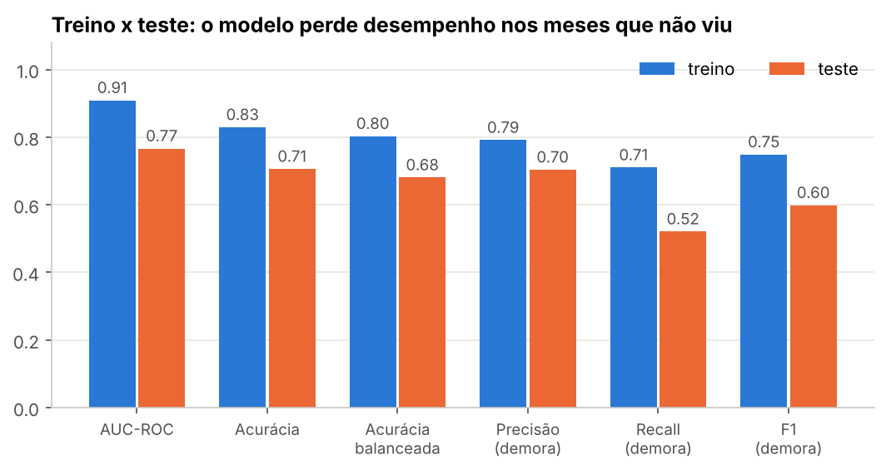

# Relatório de Machine Learning — SmartRoad Preditiva

**FIAP · Global Solution 2026.2 · CitizenTech · Inteligência Artificial & Machine Learning**
**Equipe:** Gustavo Viega Lopes Martins (RM555885), Gustavo Yuji Osugi (RM555034), Kaio Drago Lima Souza (RM556095), Otávio Santos de Lima Ferrão (RM556452) e Vitor Rivas Cardoso (RM556404)
**Notebook:** [`ml/smartroad_preditiva.ipynb`](ml/smartroad_preditiva.ipynb) · **Dados:** [`ml/dados/README.md`](ml/dados/README.md)

## 1. Problema e dados reais

No **SmartRoad** o morador de São Paulo registra buracos, bueiros quebrados e calçadas danificadas. A primeira dúvida de quem registra é *"isso vai demorar?"*, e o app não responde. O indicador de impacto da Ficha é o tempo entre o registro e a conclusão.

**Pergunta de ML:** no momento do registro, dá para prever se a ocorrência vai **demorar mais de 30 dias para ser finalizada**? É uma classificação binária supervisionada, com **série temporal**: o ritmo da Prefeitura muda com o tempo.

| | |
| --- | --- |
| Fonte | Prefeitura de São Paulo, "Dados do SP156 - Solicitações" (dados reais) |
| Link | https://dados.prefeitura.sp.gov.br/dataset/dados-do-sp156 |
| Período | pedidos abertos de 01/07/2024 a 30/06/2026 (8 arquivos trimestrais) |
| Volume | 4,7 milhões de solicitações nos arquivos; 387.605 nos 9 serviços do app (tapa-buraco, bueiros, calçadas e guias) |
| Licença | Creative Commons CC0 |

O 2º trimestre de 2024 não traz a coluna "Serviço", por isso a série começa em 01/07/2024 e fica contínua.

## 2. Escolha do modelo

Escolhemos o **XGBoost** (`XGBClassifier`):

- Os dados são uma **tabela** mista (categorias e números). Árvores costumam ser as melhores nesse formato e não exigem normalização.
- O efeito da região depende do serviço e da época. Árvores capturam essas combinações sozinhas.
- Há rótulo, então é supervisionado (KMeans + PCA não serve). A série temporal entra como **entrada**: uma LSTM precisaria de sequência longa por pedido, e cada pedido tem um único ponto no tempo.
- Frente ao Random Forest, o XGBoost tem controles diretos de complexidade (úteis para estudar overfitting) e devolve uma **probabilidade**, que é o que o app mostra.

## 3. Preparação, série temporal e divisão treino/teste

**Limpeza** (384.139 linhas, 99,1% do recorte): removemos pedidos cancelados pelo cidadão (2.241), finalizados sem data (1.106), de canal fora do dicionário (21) e com coordenadas fora da cidade (98); unificamos duas subprefeituras que mudaram de nome.

**Alvo:** `demora = 1` se o pedido não foi finalizado em até 30 dias, incluindo os ainda abertos. Todo pedido foi observado por mais de 30 dias antes da extração, então o alvo é conhecido em 100% das linhas. Demoram 35,1% dos pedidos.

**Série temporal.** A taxa de demora muda de regime: ficou entre 22% e 37% quase todo o período e saltou para 40% a 58% em janeiro de 2026.

Para cada serviço e cada subprefeitura, criamos séries diárias com 7 indicadores (14 no total): pedidos dos últimos 7 e 30 dias, fila em aberto, fila atrasada (aberta há mais de 30 dias), ritmo de finalização, taxa de demora recente (pedidos de 90 a 31 dias atrás, cujo desfecho já é conhecido) e tendência. **Anti-vazamento:** o indicador do dia D usa só eventos anteriores a D; o notebook tem um teste que refaz o cálculo com dados cortados e confere que o resultado é idêntico.

**Entradas:** serviço, canal, subprefeitura, latitude, longitude, dia da semana e os 14 indicadores (63 colunas após *one-hot*). Ficam de fora status, data de finalização e órgão do próprio pedido (vazamento) e o mês do calendário, que com 2 anos só marca a época e piorou a previsão.

**Divisão por data, com intervalo de 30 dias:** treino de 01/07/2024 a 31/03/2026 (342.311 pedidos) e teste de 01/05 a 30/06/2026 (26.459). Abril fica de fora de propósito: em 1º de maio o desfecho de um pedido de abril ainda não é conhecido. A taxa de demora foi 34,0% no treino e 42,1% no teste.

## 4. Treino com diferentes hiperparâmetros

`GridSearchCV` com **18 combinações de 3 hiperparâmetros**: `max_depth` (3, 6, 9), `learning_rate` (0,03; 0,1; 0,3) e `n_estimators` (100, 300). Validação cruzada **só no treino**, com `TimeSeriesSplit` (4 divisões, intervalo de 30 dias) e métrica AUC-ROC.

A melhor foi `max_depth=6`, `learning_rate=0.03`, `n_estimators=300` (AUC 0,800 na validação). As 7 primeiras ficam entre 0,790 e 0,800, um empate diante do desvio de 0,05 a 0,06. A mais complexa chegou a 0,987 no treino e a 0,772 na validação (decorou); a mais simples teve 0,764 (aprendeu de menos).

## 5. Resultados em treino e teste

| Métrica | Treino | Teste | Diferença |
| --- | ---: | ---: | ---: |
| AUC-ROC | 0,872 | 0,724 | 0,148 |
| Acurácia | 0,801 | 0,681 | 0,120 |
| Acurácia balanceada | 0,756 | 0,654 | 0,103 |
| Precisão (classe "demora") | 0,753 | 0,668 | 0,085 |
| Recall (classe "demora") | 0,616 | 0,481 | 0,135 |
| F1 (classe "demora") | 0,678 | 0,559 | 0,118 |
| *Linha de base: sempre "não demora" (acurácia)* | *0,660* | *0,579* | |

**Útil fora do treino:** a acurácia fica 10,2 pontos acima da linha de base. **Há overfitting:** a AUC cai 0,15 do treino para o teste, por duas causas: árvores profundas guardam detalhes do treino e a cidade mudou de regime. Com divisão por sorteio a AUC de teste seria 0,858, número inflado; a divisão por data é a honesta.

**A série temporal ajuda?** Comparamos a **persistência** (usa a taxa de demora recente do serviço, sem aprender), o XGBoost **sem** série temporal e o XGBoost **com** série temporal, também em **walk-forward** de 12 meses (retreino mensal, jul/2025 a jun/2026).

| | Persistência | Sem série temporal | **Com série temporal** |
| --- | ---: | ---: | ---: |
| AUC no teste final | 0,702 | 0,717 | **0,724** |
| AUC média, walk-forward | 0,777 | 0,782 | **0,794** |
| Brier médio, walk-forward (menor é melhor) | 0,175 | 0,177 | **0,169** |
| Erro do nível da chance prevista | 7,3 p.p. | 10,9 p.p. | **6,6 p.p.** |

- **O ganho é modesto:** aparece em 9 dos 12 meses e some em fev e mar/2026, logo após o salto de regime. O maior efeito é no **nível** da probabilidade, que é o que o app mostra.
- Os 14 indicadores somam 80% do ganho do modelo (só a taxa de demora recente, 48%), mas nenhum modelo antecipou o salto de janeiro de 2026.
- O mês do calendário piora: AUC média de 0,756 contra 0,782 sem ele.
- **Pontos fracos:** recall de 0,48 (o modelo deixa passar mais da metade das demoras) e desvio de até 10 p.p. na faixa de 40 a 60% de chance.

## 6. Conclusão: o que isso significa para o cidadão

**Sim, em parte, dá para prever.** Com o que o app sabe no registro e o histórico recente do serviço e da região, o modelo estima a chance de demora melhor do que o acaso e do que a linha de base. É uma estimativa, não uma promessa.

- **Expectativa honesta no registro.** No teste, "costumam ser finalizados em até 30 dias" apareceria em 62% dos pedidos e 69% foram mesmo finalizados no prazo; "costumam passar de 30 dias" apareceria em 22% e 77% de fato passaram. Em 16% a chance é meio a meio, e o app deve dizer isso.
- **O tipo de problema pesa mais.** No teste, passaram de 30 dias 24% dos pedidos de bueiro, 36% dos de buraco e 69% dos de calçada, o que atinge mais idosos, pessoas com deficiência e quem anda com carrinho de bebê.
- **O endereço também pesa:** em dois anos, 19% de demora no Jabaquara e 48% na Sé. Mostrar isso ajuda moradores a cobrar com dados (ODS 11 e 10).

**Limites.** "Finalizada" no SP156 é protocolo encerrado, não reparo feito. O ritmo da Prefeitura mudou em janeiro de 2026, então o modelo precisa ser retreinado todo mês. O arquivo do 1º trimestre de 2025 tem exatamente 1.048.575 linhas (limite do Excel) e pode estar incompleto. Dois anos não bastam para aprender sazonalidade.

**Próximos passos.** Mais anos de dados, chuva diária do INMET, previsão da própria série como entrada e servir o modelo pelo backend do SmartRoad, com as séries atualizadas uma vez por dia.
